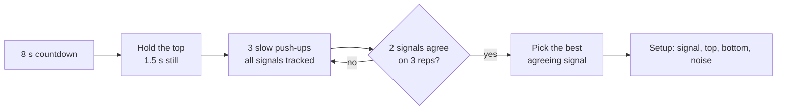
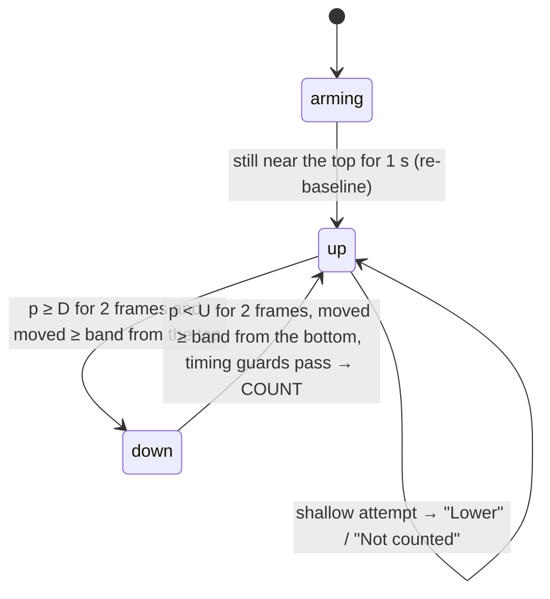

# Anyfield

Prop your phone up anywhere: a living-room floor, a park, a hotel room. The front camera counts your push-ups and keeps a daily log. It runs in mobile Safari or Chrome, and you can add it to the home screen.

## Architecture

The app is a static website with no build step and no server code of its own. Google sign-in and the synced log run on Firebase, and everything else runs on the phone.

```
public/                     the website (deployed as-is)
  index.html                the whole app: markup, CSS, JS
  firebase-config.js        Firebase web config for hosts other than Firebase Hosting
  manifest.webmanifest      home-screen install (name, colors, icons)
  icon-*.png                app icons
test/logic.test.js          tests for the counting logic, run with Node
.github/workflows/test.yml  runs the tests on every push
firebase.json, .firebaserc  Firebase config: Hosting (site anyfield) and Firestore rules
firestore.rules             Firestore security rules (private logs, group leaderboards)
```

### Runtime pipeline (all on-device)

```
front camera (getUserMedia, facingMode: user)
  → <video> frame
  → MediaPipe PoseLandmarker.detectForVideo   (WASM + WebGL, CPU fallback)
  → 33 body landmarks
  → signal extraction (one number per frame)
  → smoothing + rep state machine
  → UI (count, depth tube, skeleton overlay) + voice/beep
  → daily log: localStorage, or Firestore when signed in
```

Video never leaves the device. Apart from Firebase sign-in and sync, the only network requests are for static assets: the MediaPipe JS and WASM from jsDelivr, the pose model from Google's MediaPipe model bucket, and the Archivo font from Google Fonts. After the first load the browser caches them.

## Core algorithm

The phone can sit anywhere: on the floor in front of you, off to the side, or at an angle. No single body measurement works from every one of those spots. So the app measures several things at once, then uses a short calibration to learn which measurement works best from where the phone sits and what your top and bottom positions look like there. After that, counting is a hysteresis state machine on one number per frame, scaled so that 0 is your top and 1 is your bottom.

```
landmarks ──► 6 candidate signals ──► calibration picks one + its top/bottom ──► progress p ∈ [0,1] ──► rep state machine ──► count, cues
```

All of this lives in a pure block in `public/index.html`, between `LOGIC-START` and `LOGIC-END` (`SIGNALS`, `Calibrator`, `RepCounter`). It doesn't touch the DOM, so `test/logic.test.js` runs it in Node against simulated signals.

### 1. Pose input

- **Model:** MediaPipe `PoseLandmarker`, lite model by default (Settings → Body tracking → Precise switches to full). It runs in `VIDEO` mode, tracks one person, and uses a 0.5 confidence for detection, presence and tracking. It runs on the GPU when it can and falls back to the CPU.
- **Frames:** each new camera frame is processed once. The loop skips repaints that bring no new video frame.
- **Landmarks:** the app uses the nose (0), shoulders (11, 12), elbows (13, 14) and wrists (15, 16). A landmark with visibility below 0.5 counts as missing.
- **Coordinates:** normalized to the image, with y increasing downward. Angles and distances are computed in pixels (x·W, y·H) so the frame's aspect ratio doesn't distort them.

### 2. Signals

Each frame becomes six candidate numbers. A signal is `null` when the landmarks it needs aren't visible.

| Key | Definition | Kind | Works best from |
|---|---|---|---|
| `elbow` | Mean over visible arms of the angle shoulder–elbow–wrist, in degrees | absolute | the side |
| `chest` | mean y of the wrists − mean y of the shoulders | shift | the side or an angle |
| `head` | mean y of the wrists − y of the nose | shift | the side |
| `shoulderY` | mean y of the shoulders | shift | in front or the side |
| `headY` | y of the nose | shift | in front (weighted down, see below) |
| `scale` | shoulder width in pixels ÷ frame height | ratio | in front (you get closer to the phone at the bottom) |

The **kind** says how a signal changes when the phone is placed slightly differently from the day you calibrated:
- **absolute:** an angle, so it doesn't depend on where the phone sits.
- **shift:** moving the phone adds an offset.
- **ratio:** moving the phone nearer or farther scales the value.

Each signal also has three tolerances:

| | elbow | shift signals | scale | Meaning |
|---|---|---|---|---|
| `minSep` | 25° | 0.035 | 0.02 | smallest movement that can be a rep |
| `stab` | 6° | 0.012 | 0.008 | largest wobble that still counts as holding still |
| `floor` | 2° | 0.004 | 0.003 | lower bound on noise when scoring, so a perfectly still signal can't win by dividing by ~0 |

Shift and ratio values are fractions of the frame height. Every signal is smoothed with an exponential moving average, `v ← v + 0.5·(x − v)`, which adds about one frame of lag at 30 fps.

### 3. Calibration (`Calibrator`)

Calibration runs once per phone placement. The result is saved as a *setup*.



**Phase 1: hold.**
- The app looks at a sliding 1.5 s window, needing at least 8 frames.
- For every signal visible in at least 80% of those frames, it records the mean, μₖ, as that signal's **top**, and the standard deviation, σₖ, as its **resting noise**.
- The hold is accepted when at least 75% of those signals have σₖ ≤ `stab`ₖ.
- It fails after 25 s with "couldn't find a steady starting position".

**Phase 2: reps.** Every signal gets its own tracker, run on each frame:

```
d  = x − μ                        how far from the top
d⁺ = max d,  d⁻ = min d           running extremes
s  = sign of the first |d| ≥ minSep   which way "down" is for this signal; also starts the rep clock
p  = d / (s>0 ? d⁺ : d⁻)          depth relative to the deepest point so far (≈1 at the bottom)

up   → down  when p > 0.7
down → up    when p < 0.3          → rep candidate; its peak is the extreme d reached while down
```

The rules for what counts as a rep are what keep calibration from finishing early:
- **Duration:** a candidate is kept only if it lasts at least **600 ms**, from leaving the top (p > 0.3) to coming back (p < 0.3), and ends at least **900 ms** after the previous kept rep. That rejects nods, glances and quick shuffles.
- **Depth:** a rep is *valid* only if |peak| ≥ **0.6 ×** the deepest peak on that signal. This is recomputed every frame, so a wiggle that counted before the first real push-up is dropped as soon as a real one arrives.

**Scoring.** Each signal is scored as a separation-to-noise ratio:

```
Sₖ = wₖ · median|validPeaks| / max(σₖ, floorₖ)        (0 if median|peak| < minSepₖ)
w  = 1.25 for elbow, 0.6 for head and headY, 1 otherwise
```

Elbow angle gets a bonus because it doesn't depend on where the phone sits. Head signals are weighted down because glancing at the screen moves them.

**Agreement.** Let K be the signals with Sₖ ≥ 4, and nₖ the number of valid reps each has seen. The rep count shown and spoken during calibration is

```
N = second-largest nₖ over K        (the largest if K has one signal)
```

So **two separate measurements must both see a push-up** before it counts. One signal that dips twice per push-up (elbow angle seen from the front does this) can't end calibration early. A signal that misses reps doesn't block it either. Calibration finishes when N ≥ 3, and no sooner than 3 s after the reps phase started. After 40 s it settles on whatever it has, or fails with "couldn't pick out a clear up-and-down motion".

**Selection.** Candidates are signals with at least 2 valid reps and Sₖ > 0. The app prefers those whose count equals N, then those within 1 of N, then any. It takes the highest score among them and saves:

```
setup = { signal, up: μ, down: μ + median(validPeaks), noise: σ, score: S,
          quality: S ≥ 15 ? strong : S ≥ 7 ? good : weak }
```

A *weak* result shows a warning suggesting a better phone position.

### 4. Live counting (`RepCounter`)

Each smoothed value is converted to progress through your calibrated range:

```
p = (v − up) / (down − up)          0 = your top, 1 = your calibrated bottom
D = depth line (Settings, default 0.70, range 0.50–0.95)
U = min(0.30, D − 0.20)             "back at the top" line
```



Every frame goes through a glitch filter before smoothing, and both transitions need the same evidence: two frames in a row past the line, and a full-sized movement since the last transition.

**Arming and re-baseline.** A set starts once the values over 1 s have a standard deviation below `tol = max(stab, 3σ_cal)` and their mean progress p̄ is within 0.6 of the top. If p̄ is within 0.35, the top is re-anchored to the current mean m, so a phone placed a little differently from calibration day still counts correctly:

| Kind | up ← | down ← |
|---|---|---|
| shift | m | m + (down − up) |
| ratio | m | m · down / up |
| absolute | unchanged | unchanged |

**Glitch filter.** Pose models sometimes put a landmark in the wrong place for a few frames, most often at the bottom when your face is close to a floor-level phone. The filter works on raw progress, frame to frame:
- **Reject:** a frame whose progress jumps more than `max(0.35, 6/s · Δt) · k` from the last accepted frame is held back. No push-up moves that fast.
- **Stay rejected:** later frames stay rejected while they're closer to the glitch value than to the last good value.
- **Accept as real:** if the new level lasts 500 ms, it was a real move (or the phone moved). It's accepted and smoothing restarts from it.

**Movement size.** Each transition needs a full-sized movement, not just a line crossing:

```
amplitude = deepest p of the rep − lowest p before it     (kept for the last 3 reps)
k         = median(amplitudes), clamped to 1–3            (1 until the first rep)
band      = (D − U) · k
up → down needs   p − lowest p since the last count   ≥ band
down → up needs   deepest p since going down − p      ≥ band
```

If your reps are twice as deep as your calibration reps, a sag or wobble on the way up that dips back below D no longer looks like a new rep, because it isn't a band-sized movement. Going back to normal-depth reps shrinks k again within three reps.

**Counting.** A rep is counted on the way back up: down → up when p < U for two frames in a row and the band is covered. Three timing guards also apply:
- at least 200 ms since crossing the depth line;
- at least 600 ms since the previous rep, so a bounce at the bottom counts once;
- at least 450 ms since the dip started, so a nod can't count.

**Shallow-rep cues.** While in `up`, the app tracks the current dip: its start time t₀ (the first frame with p > U) and its deepest point e = max p.

```
attempt  = e ≥ 0.45  and  t − t₀ ≥ 350 ms
shallow  = attempt, not yet cued, and p ≤ e − 0.10      → "Lower" (once per dip)
nocount  = attempt and p < 0.15                        → "Not counted. Go lower on the next one"
```

- **When "Lower" fires:** when you start turning back up short of the depth line, while you're still low. If you then go deeper, you cross D and the rep counts. If you come up instead, "Not counted" shows at the top.
- **What can't trigger it:** a nod is too short to be an attempt, and a pause on the way down never drops by 0.10, so neither triggers a cue.

**Tracking loss.**
- **Reporting:** no value for more than 1 s (2.5 s before the first sighting) emits `lost`; the next value emits `found`.
- **Recovery:** after any gap longer than 250 ms the smoothing restarts. If you were partway down (e ≥ 0.3) and the gap lasted up to 3 s, the counter waits: back at the top (p < U) counts the rep; still past D means you're at the bottom, so the normal path takes over. This covers the common case of your face getting too close to a floor-level phone at the bottom.

### 5. Parameters

| Constant | Value | Where | Why |
|---|---|---|---|
| EMA α | 0.5 | both | removes landmark jitter, about 1 frame of lag |
| hold window | 1.5 s, ≥ 8 frames | Calibrator | long enough to measure resting noise |
| hold stability | ≥ 75% of signals with σ ≤ stab | Calibrator | lets one jittery landmark through |
| hysteresis | 0.7 / 0.3 | calibration trackers | no chatter around one threshold |
| `MIN_REP_MS` | 600 ms | calibration | nods and glances are shorter |
| `GAP_MS` | 900 ms | calibration | a double dip within one push-up is closer together |
| `KEEP` | 0.6 | calibration | drops wiggles smaller than real reps |
| weights | elbow 1.25, head 0.6, headY 0.6 | scoring | prefer placement-independent signals, avoid head motion |
| agreement | second-largest count over Sₖ ≥ 4 | calibration | two measurements must agree |
| finish | N ≥ 3, ≥ 3 s, timeout 40 s | calibration | |
| D, U | 0.70, min(0.3, D − 0.2) | counter | depth line and back-at-top line |
| `CONFIRM` | 2 frames | counter | one bad frame can't cross a line |
| `JUMP`, `VJUMP` | 0.35, 6 /s (× k) | glitch filter | faster than any push-up |
| `GLITCH_MS` | 500 ms | glitch filter | a new level that lasts is real |
| band | (D − U) · k, k = median of last 3 amplitudes in 1–3 | counter | a transition needs a full-sized movement |
| refractory | 600 ms | counter | one count per rep despite bounces |
| attempt | e ≥ 0.45 and ≥ 350 ms | counter | only real dips get a cue |
| turn | 0.10 | counter | larger than tracking noise in progress units |
| re-baseline | \|p̄\| ≤ 0.35, arm if ≤ 0.6 | counter | small phone moves are corrected, big ones need recalibration |

### 6. Failure modes it handles

| Problem | How it's handled | Test in `test/logic.test.js` |
|---|---|---|
| Nods, glances and shuffling counted during calibration | 600 ms / 900 ms timing and the 60% depth rule | *nods and shuffles: waits for the 3rd real push-up* |
| A signal that dips twice per push-up ends calibration early | Two-signal agreement; selection prefers agreeing signals | *double-dipping signal: waits for the 3rd push-up / not chosen* |
| The head moves when you look at the screen | Head signals weighted 0.6, so shoulders win from the front | *front view tracks shoulders, not the head* |
| "Lower" heard after the rep, then the next rep counts | Cue fires at the turn while you're still down; "not counted" only at the top | *shallow rep: not counted, one cue, cue before reaching the top*, *cue then deeper: counts* |
| False "lower" on full reps or pauses | Attempt rule and the 0.10 turn | *no "lower" cue on full reps*, *pause halfway then finish* |
| Bounce at the bottom counted twice | Single `down` state and 600 ms refractory | *bounce at the bottom: no double counts* |
| Phone not in exactly the same spot | Re-baseline when arming | *phone moved a little since calibration* |
| Tracking lost near the floor | Gap recovery | *tracking dropout reported and recovered*, *lost partway down, back on the way up* |
| A landmark glitch at the bottom counts twice | Glitch filter and 2-frame confirmation | *1/3/6-frame glitch at the bottom*, *glitch to almost the top* (side and front) |
| A sag or jitter on the way up counts twice | Movement-size band scaled by recent rep depth | *deep reps with a sag on the way up*, *shaky way up* |
| Deep reps make later normal reps miss | k follows the last 3 reps | *deep reps then normal-depth reps: all count* |
| Fast reps missed | Timing rules allow 0.9 s reps | *fast reps (0.9 s) all counted* |
| All of the above at once | — | *randomized disturbed sets*: 150 seeded sets × 2 views × 10 reps with random glitches, sags, wobble, bounces and dropouts; 0 extra counts, under 1% missed |

Against the counter before the double-count fix, the suite fails 10 checks, and the randomized check finds 316 extra counts in 3000 reps.

### 7. Limitations

- **One person:** the model tracks one person; others in frame can confuse it.
- **Depth is relative to calibration:** "deep enough" is measured against your calibration reps. Shallow calibration reps make counting lenient. Recalibrate if your form or the phone position changes.
- **Big phone moves:** if the phone moved a lot (|p̄| > 0.35 when arming), the top isn't re-anchored. Beyond 0.6 the set never starts and you need to recalibrate.
- **Push-ups only:** the signals and thresholds are tuned for push-ups. The pipeline itself (pose → one number per frame → calibrate → hysteresis counter) carries over to other exercises, but each needs its own signals and limits.

## App

### UI

There are three screens:
- **Home:** today's total, goal, streak, a 14-day chart and today's sets.
- **Setup:** the placement picker, then the camera view, calibration and the result.
- **Session:** the live camera, rep count, depth tube and finish button.

Settings, setups, adding a set by hand, and reviewing a finished set happen in bottom sheets.

The visual style is a dark matcha studio: deep green-black room, whisked-matcha accent, foam-white type set in Archivo. Liquid Glass is used only on controls, following Apple's guidance:
- **Every browser:** backdrop blur and saturation, a gradient rim highlight, and a highlight that follows your touch.
- **Chromium only:** the glass edges also bend what's behind them. This uses an SVG displacement map built per element and applied with `backdrop-filter: url()`, which Safari doesn't support.

### Accounts, sync and groups (Firebase)

Firebase project `home24-studio`, hosting site `anyfield`: Google sign-in, plus Firestore in us-west1, locked down by `firestore.rules`.

- **Signed out:** everything stays in `localStorage`, exactly as before.
- **Signing in:** the first time you sign in on a device, its local log and setups are copied into your account, and the local copy is cleared.
- **Signed in:** the app reads and writes Firestore. Its offline cache means a set logged without signal syncs later.
- **Daily totals:** stored as atomic increments in `users/{uid}/days/{date}`, so two devices logging at once can't overwrite each other.
- **Groups:** a group's id is its invite link (`?join=<id>`). Members see each other's daily totals, but never individual sets.
  - Each set you add or remove also bumps your score in every group you belong to.
  - That happens in a separate write, so a group problem never blocks your own log.
  - Joining a group copies in your totals for the current week.

| Path | Who can read | Who can write |
|---|---|---|
| `users/{uid}/…` (profile, sets, days, setups) | you | you |
| `boards/{bid}` | any signed-in user, by id only | owner |
| `boards/{bid}/members/{uid}` | members | yourself (join or leave); the owner can remove you |
| `boards/{bid}/scores/{day}_{uid}` | members | yourself; checked for allowed fields, a whole-number total from 0 to 5000, and a valid date |

On Firebase Hosting the app reads its config from `/__/firebase/init.json` and signs in through its own domain. That is what makes Google sign-in work in an iOS home-screen app. It needs two settings, both already in place:
- `anyfield.web.app` in Firebase Authentication → Authorized domains.
- In the project's Google OAuth web client: `https://anyfield.web.app` as a JavaScript origin and `https://anyfield.web.app/__/auth/handler` as a redirect URI.

`public/firebase-config.js` is the fallback for other hosts.

### Set videos

Recording is off by default. In Settings → Save set videos, pick a limit of 250 MB, 500 MB or 1 GB.
- **Recording:** each set is recorded with `MediaRecorder` from the moment tracking starts until Finish. Safari records MP4/H.264 and Chromium records MP4 or WebM, at about 1 Mbps (roughly 7 MB a minute).
- **Saving:** a clip is kept only if you save the set; discarding the set drops it. Clips go in IndexedDB (`anyfield-video`, keyed by the set's timestamp) and are never uploaded.
- **Limit:** when the total passes the limit, the oldest clips are deleted first. A recording stops on its own at 90% of the limit.
- **Playback:** a play chip on the set row opens a player with Save to Photos (Web Share with a file) or Download, and Delete. Deleting a set also deletes its video.
- **Count track:** when the set is also in the count log, the player shows the counter's view in step with the video: the count so far on the video, and under it the progress curve (down is down) with the depth and back-at-top lines, a numbered mark at each count and a dot at each "lower" cue. Tap the track to jump to a second before that point. This is the quickest way to see where an extra count came from.

### Count log

On by default; Settings → Count log turns it off (which deletes the log).
- **What's logged:** for each of the last 20 sets, the counter's input and output per frame: time, raw value of the chosen signal, progress, state, reps, events and all six signals. No video and no landmarks. Also the setup, depth, model, browser and, if a video was recorded, when it started in the same clock.
- **Ground truth:** the review sheet after a set already lets you fix the count. The log stores both numbers: `counted` (the counter) and `saved` (what you saved). A set you saved lower had extra counts; higher had missed ones. Discarded sets are marked `discarded`.
- **Where:** IndexedDB `anyfield-log` on the phone. When you're signed in, a gzipped copy goes to `users/{uid}/countlog/{start}` in Firestore, which only you (and the project owner) can read. Sets dropped from the last 20 are deleted there too.
- **Getting it out:** Settings → Count log → Share log sends one JSON file with every logged set. Or, from Cloud Shell, `node scripts/pull-countlog.js <your email> > countlog.json` downloads the backed-up copy (see Test).

### Storage

Everything is stored under one `localStorage` key, `pushStudio.v1`:

```js
{ setups: [{ id, name, place, signal, up, down, noise, score, quality }],
  active, goal, depth, sound, model, videoCap,          // videoCap in MB, 0 = off
  videos: { "<set t>": { size, dur, reps, type, day } }, // index of clips in IndexedDB
  countLog,                                             // count log on/off
  clog: { "<start>": { counted, saved, status, setT, cloud } }, // index of the count log in IndexedDB
  log: { "YYYY-MM-DD": { sets: [{ t, reps, setup, manual }] } } }
```

Data is tied to the device and to the site address, so changing the address starts a fresh log. On iOS, add the app to the home screen so Safari doesn't clear site storage after a week of not opening it. Use Settings → Export CSV for backups.

## iOS app

The iOS app is the same page in a native shell ([Capacitor](https://capacitorjs.com) 8). The counter, UI and data model are shared. The page checks `Capacitor.isNativePlatform()` (`NATIVE`) and changes only what has to be different in an app:

| | Website | App |
|---|---|---|
| MediaPipe, pose models, Firebase SDK, font | CDNs | bundled in the app by `scripts/build-app-www.js`, so counting works offline |
| Sign-in | Google popup or redirect | a sheet with **Continue with Apple** and **Continue with Google**. The native SDKs sign in through `@capacitor-firebase/authentication` (`skipNativeAuth`), and the token signs in Firebase's JS SDK with `signInWithCredential`. Auth uses `initializeAuth` with IndexedDB persistence. |
| Screen stays on during a set | Wake Lock API | `@capacitor-community/keep-awake` |
| Rep feedback | sound or voice | sound or voice, plus a haptic tick (`@capacitor/haptics`) |
| Save video, share the count log, invite | Web Share or download | the iOS share sheet (`@capacitor/filesystem` + `@capacitor/share`) |
| Invite links | this site | always `https://anyfield.web.app/?join=…` |

Both have **Settings → Delete account**, which deletes the Firestore data (sets, days, setups, count log, group memberships and scores, profile) and then the Firebase account. If the last sign-in is older than 4 minutes, it asks you to sign in again first. App Store review requires this (guideline 5.1.1(v)), and it requires Sign in with Apple next to Google (4.8). The privacy policy is `public/privacy.html`.

**Project:** `capacitor.config.json` (app id `app.anyfield`), `ios/App` (Xcode project, Swift Package Manager), `ios/App/App/Info.plist` (camera and Photos usage text, portrait on iPhone, no encryption export), `App.entitlements` (Sign in with Apple), and an app icon redrawn at 1024 px from the web icon.

**Build:** `npm ci && npm run app:sync`, then open `ios/App/App.xcodeproj` in Xcode on a Mac. No Mac is needed for CI: `.github/workflows/ios.yml` runs on GitHub's macOS runners.
- **simulator:** tests, builds the app bundle, builds for the iOS Simulator without signing, launches the app, and saves a screenshot and the app log as the `ios-simulator` artifact.
- **testflight:** archives a Release build, signs it automatically with an App Store Connect API key, and uploads it. The build number is 1000 + the run number. Until the secrets below exist, it only prints a notice.

**To ship (needs the Apple Developer Program, $99/year):**
1. **Enroll** at developer.apple.com, as an individual or as the LLC (which needs a D-U-N-S number).
2. **Register the app:** Certificates, Identifiers & Profiles → Identifiers → **+** → App IDs, bundle ID `app.anyfield`, with **Sign in with Apple** checked. Then in App Store Connect → Apps → **+** → New App, pick that bundle ID.
3. **API key for CI:** App Store Connect → Users and Access → Integrations → App Store Connect API → Team Keys → **+**, with the App Manager role. Download the `.p8` file (it can be downloaded only once).
4. **GitHub secrets** (repo → Settings → Secrets and variables → Actions): `ASC_KEY_ID`, `ASC_ISSUER_ID`, `ASC_KEY_P8` (the whole `.p8` file), and `APPLE_TEAM_ID` (developer account → Membership). The next push to `main` uploads a build.
5. **Firebase (done):** the iOS app `app.anyfield` is registered in project `home24-studio`. Its `GoogleService-Info.plist` is in `ios/App/App`, and its `REVERSED_CLIENT_ID` is a URL scheme in `Info.plist`. The Apple provider is turned on in Firebase Authentication.
6. **TestFlight:** add an external testing group with a public link. The first build goes through Beta App Review. Put the link in `APP_LINK` in `public/index.html` and the website shows **Get the app** on Apple devices. After App Store release, change `APP_LINK` to the App Store link.

## Run

The camera needs HTTPS, except on `localhost`.

- **Live:** https://anyfield.web.app, on Firebase Hosting (project `home24-studio`, site `anyfield`). On iPhone or iPad, open it in Safari, tap Share → Add to Home Screen.
- **Deploy:** automatic. Every push to `main` that changes `public/`, `firebase.json` or the workflow runs `.github/workflows/deploy.yml`: the tests, then `firebase deploy --only hosting`, then a check of the live page. It signs in to Google Cloud with Workload Identity Federation, so no key is stored: the `github-deploy` service account has Hosting-only roles, and only runs from `wintokk/home24-studio` on `main` can use it. `scripts/setup-auto-deploy.sh` created this once (run in Cloud Shell). To deploy by hand: `firebase deploy --only hosting --project home24-studio`.
- **Local:**

```sh
python3 -m http.server 8000 --directory public    # desktop: http://localhost:8000
```

## Test

```sh
node test/logic.test.js                      # 47 checks
node test/logic.test.js path/to/index.html   # run the same checks against another copy of the app
node test/replay.js countlog.json            # replay every logged set through the current counter
node test/replay.js countlog.json --set 3    # one set, frame by frame where anything happened (--frames for all)
node scripts/pull-countlog.js <email> > countlog.json   # in Cloud Shell: download a user's backed-up count log
```

The tests generate push-up timelines (holds, reps of chosen depth and speed, pauses, bounces, nods, shuffles, landmark glitches, sags, wobble, tracking gaps). They turn each into per-signal values as a side camera and a floor-in-front camera would see them, with tracking noise, then run them through `Calibrator` and `RepCounter`. The failure-modes table above lists which check covers which behaviour.

**Real sets.** `test/replay.js` reads a count log (see App → Count log) and runs every set's frames through the current `RepCounter`. Per set it prints what the phone counted, what was saved, and what this version counts, and it exits non-zero when this version disagrees with a saved count. A miscount on the phone becomes a reproducible case: fix the counter until the replay matches what you saved, and check that the other logged sets still match. With `--set N` it prints each frame where something happened, with the video time, so it lines up with the count track in the player.
